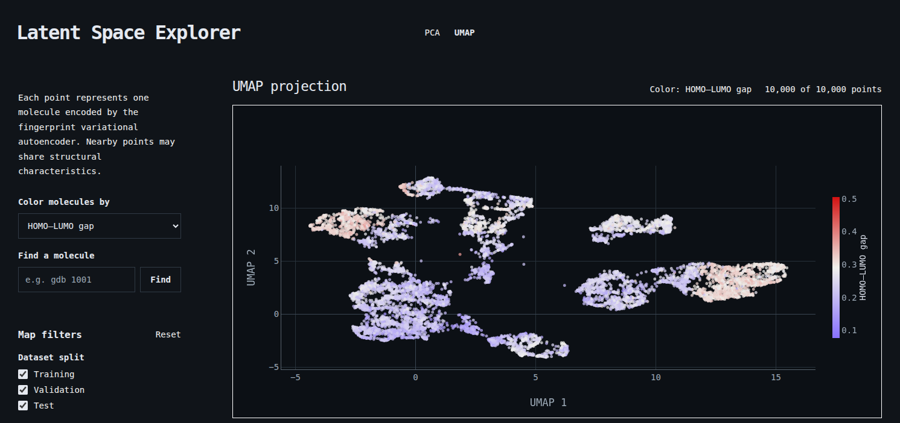
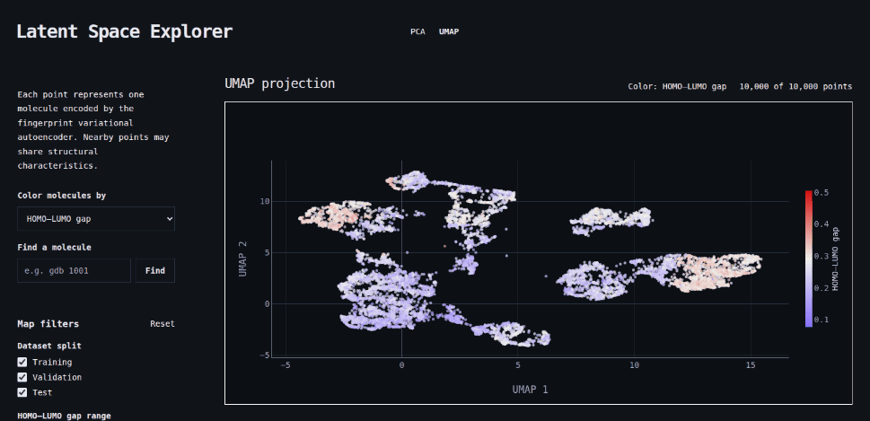

<h1 align="center">Latent Space Explorer</h1>

<p align="center">
An interactive and reproducible analysis of molecular representations learned by a fingerprint variational autoencoder.
</p>

<p align="center">
<a target="_blank" href="https://latent-space-explorer-black.vercel.app/"><strong>Open the live explorer</strong></a>
</p>



## Overview

Latent Space Explorer trains a variational autoencoder (VAE) on Morgan fingerprints of 10,000 QM9 molecules and asks whether the learned 16-dimensional latent space is chemically meaningful.

The project has two parts:

- **A reproducible Python pipeline** that prepares the dataset, trains and evaluates the model, exports latent vectors, and measures latent-space organization, neighbor similarity, reconstruction quality, and robustness.
- **An interactive web explorer** that displays every molecule on PCA and UMAP maps, colors them by molecular properties, and compares each held-out test molecule with its nearest latent neighbors.



## Key results

All results come from a deterministic 10,000-molecule QM9 subset split into 8,000 training, 1,000 validation, and 1,000 held-out test molecules.

| Question | Result |
|---|---|
| Are latent neighbors structurally similar? | Nearest latent neighbors have a mean Morgan-fingerprint Tanimoto similarity of **0.231**, compared with **0.077** for random training molecules. The nearest neighbor beats a random reference for **94.9%** of test queries. |
| Does latent distance measure similarity? | Only weakly. The Spearman correlation between latent distance and Tanimoto similarity is **−0.125**. |
| How well are fingerprints reconstructed? | With a validation-selected threshold, held-out reconstruction reaches an F1 score of **0.494** and a mean Tanimoto similarity of **0.331**. |
| Are the results stable? | Across three seeds and latent sizes of 8, 16, and 32, mean reconstruction F1 stays at **0.495**, with seed-to-seed standard deviations of 0.003 to 0.012. The 16-dimensional model varies least. |

The latent space clearly enriches for fingerprint similarity, but it is not a complete measure of chemical similarity. See [LIMITATIONS.md](docs/LIMITATIONS.md) for the full scope.

## Quick start

### Run the web explorer

The validated browser data is committed, so the explorer runs without the Python pipeline. It requires Node.js 20.19+ or 22.12+.

```bash
cd web
npm ci
npm run dev
```

### Reproduce the scientific pipeline

The pipeline requires Python 3.12. The experiments ran on CPU, so the CPU-only PyTorch build is enough:

```bash
python -m venv venv
source venv/bin/activate  # Windows: venv\Scripts\activate
pip install torch==2.13.0 --index-url https://download.pytorch.org/whl/cpu
pip install -r requirements.txt
```

Then follow [REPRODUCIBILITY.md](docs/REPRODUCIBILITY.md), which runs each stage from dataset preparation to browser-data export and lists the expected artifacts and results.

Run the backend test suite with:

```bash
python -m unittest discover -s tests -v
```

## Technology

| Area | Tools |
|---|---|
| Cheminformatics | RDKit |
| Model | PyTorch |
| Analysis | NumPy, pandas, scikit-learn, UMAP, Matplotlib |
| Web explorer | React, Vite, Plotly (WebGL) |
| Quality checks | GitHub Actions (lint, build, and backend tests on every pull request) |
| Hosting | Vercel |

## Repository structure

| Path | Contents |
|---|---|
| `backend/` | Dataset preparation, preprocessing, model, training, analysis, and export modules |
| `configs/` | YAML configuration for each pipeline stage |
| `tests/` | Backend unit tests |
| `web/` | React and Plotly explorer, including the exported browser data in `web/public/data/` |
| `docs/` | Methodology, experiments, analyses, decisions, and figures |

## Documentation

### System understanding

| Document | Description |
|---|---|
| [ARCHITECTURE.md](docs/ARCHITECTURE.md) | System structure, components, and data flow. |
| [METHODOLOGY.md](docs/METHODOLOGY.md) | Data representation, model design, and training approach. |
| [DATASET.md](docs/DATASET.md) | Dataset source, preparation workflow, provenance, and generated artifacts. |
| [PROJECT_STATUS.md](docs/PROJECT_STATUS.md) | Completed milestones, results, and known limitations. |
| [Web application](web/README.md) | Explorer features, local setup, deployment, and scientific boundaries. |

### Research process

| Document | Description |
|---|---|
| [RESEARCH_QUESTIONS.md](docs/RESEARCH_QUESTIONS.md) | Scientific questions guiding the project. |
| [DECISIONS.md](docs/DECISIONS.md) | Design decisions, rationale, and trade-offs. |
| [LIMITATIONS.md](docs/LIMITATIONS.md) | Current constraints and future improvements. |

### Experiments and analyses

| Document | Description |
|---|---|
| [EXPERIMENTS.md](docs/EXPERIMENTS.md) | Training runs, configurations, and interpretations. |
| [LATENT_EXPORT.md](docs/LATENT_EXPORT.md) | Latent-vector export, schema, and provenance. |
| [PCA_ANALYSIS.md](docs/PCA_ANALYSIS.md) | PCA projection and interpretation. |
| [UMAP_ANALYSIS.md](docs/UMAP_ANALYSIS.md) | UMAP projection and comparison with PCA. |
| [PROPERTY_ANALYSIS.md](docs/PROPERTY_ANALYSIS.md) | Property-colored latent maps. |
| [LATENT_NEIGHBOR_ANALYSIS.md](docs/LATENT_NEIGHBOR_ANALYSIS.md) | Latent-neighbor retrieval and Tanimoto similarity. |
| [FINGERPRINT_RECONSTRUCTION.md](docs/FINGERPRINT_RECONSTRUCTION.md) | Held-out fingerprint reconstruction metrics. |
| [ROBUSTNESS_ANALYSIS.md](docs/ROBUSTNESS_ANALYSIS.md) | Multi-seed and latent-dimension comparison. |
| [WEB_DATA_EXPORT.md](docs/WEB_DATA_EXPORT.md) | Browser data contracts and integrity checks. |
| [REPRODUCIBILITY.md](docs/REPRODUCIBILITY.md) | Environment setup and full reproduction workflow. |

### Reference

| Document | Description |
|---|---|
| [GLOSSARY.md](docs/GLOSSARY.md) | Machine learning and cheminformatics terminology. |
| [FIGURES/README.md](docs/FIGURES/README.md) | Figure index and visualization guidelines. |

## Data source

The molecules come from QM9:

> Ramakrishnan, R., Dral, P., Rupp, M., and von Lilienfeld, O. A. *Quantum chemistry structures and properties of 134 kilo molecules.* Scientific Data **1**, 140022 (2014).

## License

Released under the [MIT License](LICENSE).
