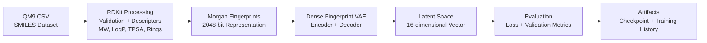

<div align="justify">
    
# Current Architecture

## Scope and status

Latent Space Explorer currently provides the first half of a molecular latent-space workflow: it converts SMILES data into fixed-length molecular fingerprints, trains a variational autoencoder (VAE), and saves a model checkpoint with training history. The browser application is scaffolded with React and Vite, but it is not yet connected to the machine-learning pipeline or a 3D renderer.

This document describes the implementation that exists in the repository today. Planned capabilities, including a FastAPI service, Three.js rendering, exported latent coordinates, and molecular interpolation, are intentionally excluded from the current system diagram.

## System overview



## Repository components

| Location | Responsibility |
| --- | --- |
| `data/qm9_sample.csv` | Small CSV development dataset. A `smiles` column is required; optional `id` and `gap` columns are retained in metadata. |
| `backend/data_handler.py` | Reads a CSV file and checks for the required `smiles` column. |
| `backend/preprocessing.py` | Parses SMILES with RDKit, calculates descriptors, creates Morgan fingerprints, and writes processed artifacts. |
| `backend/dataset.py` | Loads the fingerprint matrix and exposes it as a PyTorch dataset. |
| `backend/model.py` | Defines `MolecularVAE`, a fully connected VAE. |
| `backend/training.py` | Defines the VAE loss and epoch-based training loop. |
| `backend/config.py` | Loads an experiment YAML file and checks that its required sections are present. |
| `backend/run_preprocessing.py` | Command-line entry point for preprocessing the sample CSV. |
| `backend/run_training.py` | Command-line entry point that loads an experiment configuration, trains the model, and writes a checkpoint. |
| `configs/fingerprint_vae.yaml` | Default Fingerprint VAE experiment settings. |
| `web/` | Independent React/Vite frontend scaffold; it has no model-data integration yet. |

## Data preprocessing

Run preprocessing from the project root:

```powershell
python -m backend.run_preprocessing
```

For each valid SMILES string, RDKit creates a canonical molecular representation and the following descriptors:

- molecular weight
- LogP
- total and heavy atom counts
- hydrogen-bond donor and acceptor counts
- topological polar surface area (TPSA)
- ring count

The pipeline uses an RDKit Morgan fingerprint generator with radius `2` and size `2048`. Each fingerprint is stored as a float32 binary vector. Invalid SMILES strings are counted and excluded; if no valid molecules remain, preprocessing raises an error.

The resulting artifacts are written to `data/processed/`:

- `molecules_metadata.csv`: source index, ID, canonical SMILES, descriptors, and optional HOMO-LUMO gap value.
- `morgan_fingerprints.npy`: a matrix shaped `(number_of_molecules, 2048)`.

## Model architecture

`MolecularVAE` is a dense, fingerprint-based VAE. It is not currently a convolutional or graph neural-network model.

```text
Input: Morgan fingerprint (2048)
  -> Linear(2048, 512) + ReLU
  -> Linear(512, 128) + ReLU
  -> mu:      Linear(128, 16)
  -> log_var: Linear(128, 16)
  -> reparameterization: z = mu + eps * exp(0.5 * log_var)
  -> Linear(16, 128) + ReLU
  -> Linear(128, 512) + ReLU
  -> Linear(512, 2048)
Output: reconstruction logits (2048)
```

The default configuration sets the latent dimension to `16`. The decoder returns logits rather than probabilities, which are consumed directly by the binary cross-entropy loss.

## Training

Run the default configured training experiment after preprocessing:

```powershell
python -m backend.run_training
```

The training entry point loads the following default values from `configs/fingerprint_vae.yaml`:

| Setting | Value |
| --- | --- |
| random seed | 42 |
| batch size | 64 |
| learning rate | 0.001 |
| epochs | 50 |
| optimizer | Adam |
| device | CUDA when available, otherwise CPU |

Use `python -m backend.run_training --config path/to/experiment.yaml` to select another configuration. The selected configuration determines the dataset path, model dimensions, training hyperparameters, seed, and checkpoint path.

For each batch, the objective is:

`total loss = binary cross-entropy with logits + KL divergence`

Both terms use sum reduction within a batch. The training loop reports per-sample total, reconstruction, and KL losses after each epoch. The configured `validation_fraction` creates a deterministic non-empty train/validation split using the experiment seed; validation runs without gradient updates and records the same three metrics. There is still no test split, early stopping, or metric logging service.

At the end of training, `models/molecular_vae.pt` contains the model state dictionary, experiment name, model configuration, training configuration, seed, and in-memory training history. Processed data and checkpoints are ignored by Git.

## Frontend boundary

The `web/` directory is a standard React/Vite application. Its current interface is the starter screen and its dependencies do not yet include Three.js or React Three Fiber. No API, static JSON export, or endpoint currently transports molecule metadata, latent vectors, reconstructions, or interpolation results to the browser.

## Current constraints

- The tracked sample data contains only a few molecules and is suitable for checking the pipeline, not for scientific training or evaluation. Its one-molecule validation subset is not statistically meaningful.
- A dense VAE over Morgan fingerprints can reconstruct fingerprint features, but does not decode directly to chemically valid SMILES or molecular graphs.
- The repository does not yet export latent vectors for visualization.
- No FastAPI application or inference endpoint is currently implemented, despite FastAPI appearing in the dependency list.

## Next architectural increment

The next model-quality increment is a larger documented QM9 subset with train, validation, and test partitions. Once model quality can be assessed beyond the development sample, the next integration step is an export stage that encodes each processed fingerprint with its mean latent vector (`mu`), reduces those vectors to three display coordinates, and writes a versioned JSON artifact joined with `molecules_metadata.csv`. The frontend can then render a real molecular point cloud without requiring a live API.
</div>
