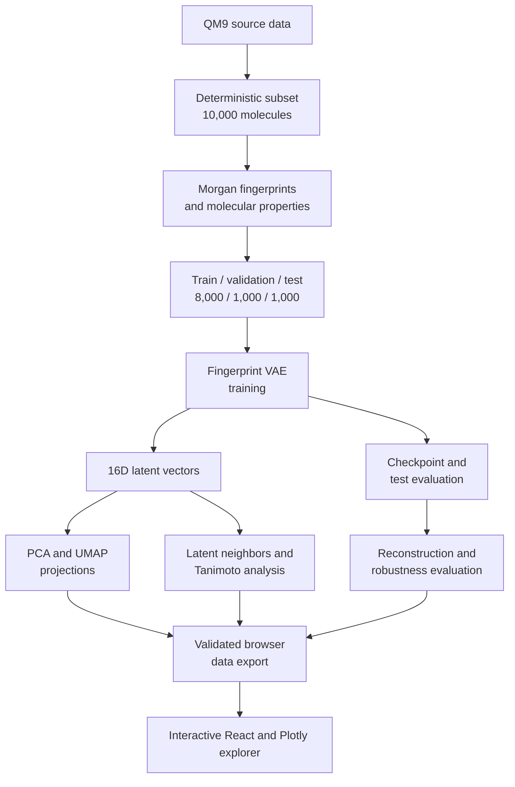

<div align="justify">
    
# Current Architecture

## Scope and status

Latent Space Explorer provides an end-to-end molecular representation workflow. It prepares QM9 fingerprints, trains and evaluates a variational autoencoder, exports deterministic latent vectors, analyzes latent organization, evaluates molecular neighbors and fingerprint reconstruction, exports validated browser data, and provides an interactive React/Plotly explorer.

## System overview



## Repository components

| Location | Responsibility |
| --- | --- |
| `data/qm9_sample.csv` | Small CSV development dataset. A `smiles` column is required; optional `id` and `gap` columns are retained in metadata. |
| `backend/data_handler.py` | Reads a CSV file and checks for the required `smiles` column. |
| `backend/preprocessing.py` | Parses SMILES with RDKit, calculates descriptors, creates Morgan fingerprints, and writes processed artifacts. |
| `backend/dataset.py` | Loads the fingerprint matrix and exposes it as a PyTorch dataset. |
| `backend/model.py` | Defines `MolecularVAE`, a fully connected VAE. |
| `backend/training.py` | Defines the VAE loss and epoch-based training loop. |
| `backend/config.py` | Loads an experiment YAML file and checks that its required sections are present. |
| `backend/run_preprocessing.py` | Command-line entry point for preprocessing the sample CSV. |
| `backend/run_training.py` | Command-line entry point that loads an experiment configuration, trains the model, and writes a checkpoint. |
| `backend/prepare_qm9.py` | Downloads, validates, and prepares the deterministic QM9 subset. |
| `backend/splits.py` | Creates deterministic, non-overlapping train, validation, and test split indices. |
| `backend/plot_training_history.py` | Generates the versioned QM9 training-history figure. |
| `configs/qm9_subset.yaml` | Defines deterministic QM9 subset preparation settings. |
| `configs/qm9_processing.yaml` | Defines QM9 preprocessing and split settings. |
| `configs/qm9_fingerprint_vae.yaml` | Defines the QM9 Fingerprint VAE baseline training settings. |
| `configs/fingerprint_vae.yaml` | Default Fingerprint VAE experiment settings. |
| `web/` | Interactive React/Vite and Plotly application for PCA/UMAP exploration, property coloring, molecule search, filtering, inspection, and neighbor comparison. |
| `backend/export_web_data.py` | Validates aligned scientific artifacts and exports browser-ready JSON contracts. |
| `configs/qm9_web_export.yaml` | Defines browser-export inputs, precision, properties, schema, and output paths. |
| `web/public/data/` | Versioned molecule, neighbor, metrics, and manifest data served by the frontend. |

## Data preprocessing

Run preprocessing from the project root:

```powershell
python -m backend.run_preprocessing
```

For each valid SMILES string, RDKit creates a canonical molecular representation and the following descriptors:

- molecular weight
- LogP
- total and heavy atom counts
- hydrogen-bond donor and acceptor counts
- topological polar surface area (TPSA)
- ring count

The pipeline uses an RDKit Morgan fingerprint generator with radius `2` and size `2048`. Each fingerprint is stored as a float32 binary vector. Invalid SMILES strings are counted and excluded; if no valid molecules remain, preprocessing raises an error.

The resulting artifacts are written to `data/processed/`:

- `molecules_metadata.csv`: source index, ID, canonical SMILES, descriptors, and optional HOMO-LUMO gap value.
- `morgan_fingerprints.npy`: a matrix shaped `(number_of_molecules, 2048)`.

## Model architecture

`MolecularVAE` is a dense, fingerprint-based VAE. It is not currently a convolutional or graph neural-network model.

```text
Input: Morgan fingerprint (2048)
  -> Linear(2048, 512) + ReLU
  -> Linear(512, 128) + ReLU
  -> mu:      Linear(128, 16)
  -> log_var: Linear(128, 16)
  -> reparameterization: z = mu + eps * exp(0.5 * log_var)
  -> Linear(16, 128) + ReLU
  -> Linear(128, 512) + ReLU
  -> Linear(512, 2048)
Output: reconstruction logits (2048)
```

The default configuration sets the latent dimension to `16`. The decoder returns logits rather than probabilities, which are consumed directly by the binary cross-entropy loss.

## Training

Run the default configured training experiment after preprocessing:

```powershell
python -m backend.run_training
```

The training entry point loads the following default values from `configs/fingerprint_vae.yaml`:

| Setting | Value |
| --- | --- |
| random seed | 42 |
| batch size | 64 |
| learning rate | 0.001 |
| epochs | 50 |
| optimizer | Adam |
| device | CUDA when available, otherwise CPU |

Use `python -m backend.run_training --config path/to/experiment.yaml` to select another configuration. The selected configuration determines the dataset path, model dimensions, training hyperparameters, seed, and checkpoint path.

For each batch, the objective is:

`total loss = binary cross-entropy with logits + KL divergence`

Both terms use sum reduction within a batch. The QM9 workflow uses deterministic, non-overlapping training, validation, and held-out test splits. Training metrics are recorded after each epoch, the best checkpoint is selected using validation loss, and the held-out test split is evaluated only after checkpoint selection.

At the end of training, `models/molecular_vae.pt` contains the model state dictionary, experiment name, model configuration, training configuration, seed, and in-memory training history. Processed data and checkpoints are ignored by Git.

## Current constraints

- The model reconstructs Morgan fingerprints rather than valid molecular graphs or SMILES strings.
- The main experiment uses a deterministic 10,000-molecule QM9 subset.
- PCA and UMAP cannot preserve every relationship in the original latent space.
- Exported neighbor results cover the 1,000 held-out test queries.
- The dense fingerprint VAE is a baseline architecture.
- The browser consumes static scientific artifacts and does not perform model inference.
- The Plotly dependency produces a relatively large production JavaScript bundle.

## Browser integration

The Python backend exports versioned static JSON artifacts containing:

- aligned molecule identities and canonical SMILES;
- train, validation, and test labels;
- PCA and UMAP coordinates;
- molecular properties;
- nearest neighbors for held-out test queries;
- reconstruction, neighbor, and robustness metrics;
- schema and checksum metadata.

The React frontend validates and loads these artifacts before rendering the Plotly WebGL visualization. It supports projection switching, property coloring, molecule search, split and property filtering, molecule inspection, and neighbor comparison.

Scientific computation remains in the Python backend. The browser does not train the VAE, calculate latent vectors, or recompute evaluation metrics.
</div>
