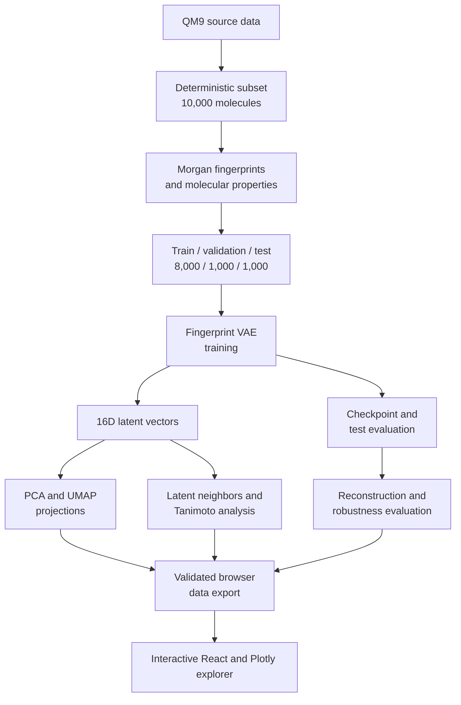

<div align="justify">
    
# Current Architecture

## Scope and status

Latent Space Explorer provides an end-to-end molecular representation workflow. It prepares QM9 fingerprints, trains and evaluates a variational autoencoder, exports deterministic latent vectors, analyzes latent organization, evaluates molecular neighbors and fingerprint reconstruction, exports validated browser data, and provides an interactive React/Plotly explorer.

## System overview



## Repository components

| Location | Responsibility |
| --- | --- |
| `backend/prepare_qm9.py` | Downloads, validates, and prepares the deterministic QM9 subset. |
| `backend/data_handler.py` | Reads a CSV file and checks for the required `smiles` column. |
| `backend/preprocessing.py` | Parses SMILES with RDKit, calculates descriptors, creates Morgan fingerprints, and writes processed artifacts. |
| `backend/splits.py` | Creates deterministic, non-overlapping train, validation, and test split indices. |
| `backend/run_preprocessing.py` | Command-line entry point for QM9 preprocessing and split creation. |
| `backend/dataset.py` | Loads the fingerprint matrix and exposes it as a PyTorch dataset. |
| `backend/model.py` | Defines `MolecularVAE`, a fully connected VAE. |
| `backend/training.py` | Defines the VAE loss, the epoch-based training loop, and validation-based checkpoint selection. |
| `backend/config.py` | Loads an experiment YAML file and checks that its required sections are present. |
| `backend/run_training.py` | Trains the model from a configuration, evaluates the selected checkpoint on the test split, and writes the checkpoint and results. |
| `backend/plot_training_history.py` | Generates the versioned training-history figure. |
| `backend/export_latent_vectors.py` | Exports deterministic latent mean vectors for all molecules. |
| `backend/plot_latent_pca.py` | Fits PCA on training latents, projects all molecules, and plots the result. |
| `backend/plot_latent_umap.py` | Fits UMAP on training latents, projects all molecules, and plots the result. |
| `backend/plot_latent_properties.py` | Creates property-colored PCA and UMAP figures. |
| `backend/analyze_latent_neighbors.py` | Retrieves test-to-training latent neighbors and compares them with Tanimoto similarity and a random baseline. |
| `backend/evaluate_fingerprint_reconstruction.py` | Selects a reconstruction threshold on validation data and evaluates the held-out test split. |
| `backend/run_robustness_analysis.py` | Trains and evaluates the nine-run seed and latent-dimension comparison. |
| `backend/export_web_data.py` | Validates aligned scientific artifacts and exports browser-ready JSON contracts. |
| `configs/` | One YAML configuration per pipeline stage, prefixed `qm9_`, plus `fingerprint_vae.yaml` for the development sample. |
| `data/qm9_sample.csv` | Three-molecule development sample used only to smoke-test the pipeline. |
| `tests/` | Backend unit tests that run on small synthetic data. |
| `web/` | Interactive React/Vite and Plotly application for PCA/UMAP exploration, property coloring, molecule search, filtering, inspection, and neighbor comparison. |
| `web/public/data/` | Versioned molecule, neighbor, metrics, and manifest data served by the frontend. |
| `.github/workflows/ci.yml` | Runs web lint and build and the backend tests on every pull request and push to `main`. |

## Data preprocessing

Run preprocessing from the project root after preparing the QM9 subset:

```bash
python -m backend.run_preprocessing
```

The command reads `configs/qm9_processing.yaml` by default. For each valid SMILES string, RDKit creates a canonical molecular representation and the following descriptors:

- molecular weight
- LogP
- total and heavy atom counts
- hydrogen-bond donor and acceptor counts
- topological polar surface area (TPSA)
- ring count

The pipeline uses an RDKit Morgan fingerprint generator with radius `2` and size `2048`. Each fingerprint is stored as a float32 binary vector. Invalid SMILES strings are counted and excluded; if no valid molecules remain, preprocessing raises an error.

The resulting artifacts are written to `data/processed/qm9/`:

- `molecules_metadata.csv`: source index, ID, canonical SMILES, descriptors, and the QM9 HOMO-LUMO gap.
- `morgan_fingerprints.npy`: a matrix shaped `(number_of_molecules, 2048)`.
- `split_indices.npz`: deterministic, non-overlapping train, validation, and test indices.
- `preparation_summary.json`: input and output paths, valid and rejected molecule counts, fingerprint shape, split seed, and split sizes.

## Model architecture

`MolecularVAE` is a dense, fingerprint-based VAE. It is not currently a convolutional or graph neural-network model.

```text
Input: Morgan fingerprint (2048)
  -> Linear(2048, 512) + ReLU
  -> Linear(512, 128) + ReLU
  -> mu:      Linear(128, 16)
  -> log_var: Linear(128, 16)
  -> reparameterization: z = mu + eps * exp(0.5 * log_var)
  -> Linear(16, 128) + ReLU
  -> Linear(128, 512) + ReLU
  -> Linear(512, 2048)
Output: reconstruction logits (2048)
```

The default configuration sets the latent dimension to `16`. The decoder returns logits rather than probabilities, which are consumed directly by the binary cross-entropy loss.

## Training

Run the QM9 baseline training after preprocessing:

```bash
python -m backend.run_training
```

The command reads `configs/qm9_fingerprint_vae.yaml` by default:

| Setting | Value |
| --- | --- |
| random seed | 42 |
| batch size | 128 |
| learning rate | 0.001 |
| epochs | 50 |
| optimizer | Adam |
| device | CUDA when available, otherwise CPU |

Use `python -m backend.run_training --config path/to/experiment.yaml` to select another configuration. The selected configuration determines the dataset paths, model dimensions, training hyperparameters, seed, and output paths.

For each batch, the objective is:

`total loss = binary cross-entropy with logits + KL divergence`

Both terms use sum reduction within a batch. Training uses the deterministic, non-overlapping training, validation, and held-out test splits. Training metrics are recorded after each epoch, the best checkpoint is selected using validation loss, and the held-out test split is evaluated only after checkpoint selection.

Training writes two artifacts:

- `models/qm9_fingerprint_vae.pt`: the selected model state, configuration, seed, dataset sizes, best epoch, test metrics, and training history.
- `models/qm9_fingerprint_vae_results.json`: the same metrics and history without model weights.

Processed data and checkpoints are ignored by Git.

## Current constraints

- The model reconstructs Morgan fingerprints rather than valid molecular graphs or SMILES strings.
- The main experiment uses a deterministic 10,000-molecule QM9 subset.
- PCA and UMAP cannot preserve every relationship in the original latent space.
- Exported neighbor results cover the 1,000 held-out test queries.
- The dense fingerprint VAE is a baseline architecture.
- The browser consumes static scientific artifacts and does not perform model inference.
- The explorer bundles Plotly's 2D WebGL build, which keeps the production JavaScript at about 570 kB compressed.

## Browser integration

The Python backend exports versioned static JSON artifacts containing:

- aligned molecule identities and canonical SMILES;
- train, validation, and test labels;
- PCA and UMAP coordinates;
- molecular properties;
- nearest neighbors for held-out test queries;
- reconstruction, neighbor, and robustness metrics;
- schema and checksum metadata.

The React frontend validates and loads these artifacts before rendering the Plotly WebGL visualization. It supports projection switching, property coloring, molecule search, split and property filtering, molecule inspection, and neighbor comparison.

Scientific computation remains in the Python backend. The browser does not train the VAE, calculate latent vectors, or recompute evaluation metrics.
</div>
