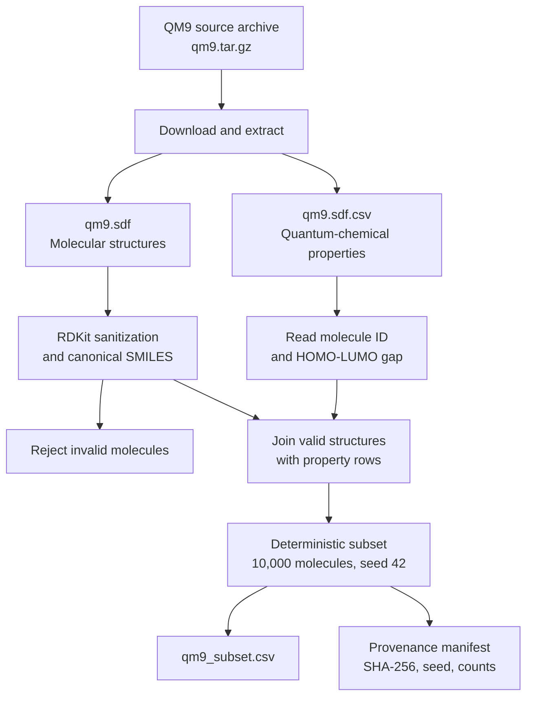

# Dataset Documentation

## Current development dataset

The repository includes:

```text
data/qm9_sample.csv
```
This three-molecule sample exists only to verify CSV ingestion, RDKit preprocessing, Fingerprint VAE training, validation, and checkpoint generation.

It must not be used for scientific model evaluation.

# QM9 subset for baseline experiments

The next training dataset is a deterministic subset of QM9.

QM9 contains small organic molecules with quantum-chemical properties. The preparation workflow uses an SDF structure file and a companion CSV property table containing the HOMO-LUMO gap (`gap`).

## Source

The preparation script downloads:

```text
https://deepchemdata.s3.us-west-1.amazonaws.com/datasets/qm9.tar.gz
```

The archive is the QM9 source used by DeepChem's QM9 loader and contains:

- `qm9.sdf`
- `qm9.sdf.csv`

The original QM9 collection should be cited as:

> Ramakrishnan, R., Dral, P., Rupp, M., and von Lilienfeld, O. A. *Quantum chemistry structures and properties of 134 kilo molecules.* Scientific Data **1**, 140022 (2014).

Original collection:

```text
https://figshare.com/collections/Quantum_chemistry_structures_and_properties_of_134_kilo_molecules/978904
```

## Preparation workflow



Run:

```bash
python -m backend.prepare_qm9
```

The workflow:

- downloads the QM9 archive if it is not already present;
- extracts the SDF structures and property table;
- loads molecular structures with RDKit;
- creates canonical SMILES;
- retains molecule ID, SMILES, and HOMO-LUMO gap;
- selects a deterministic subset using the configured seed;
- writes a standardized CSV and provenance manifest.

## Configuration

The default subset configuration is stored in:

```text
configs/qm9_subset.yaml
```

Default values:

| Setting | Value |
|----------|-------|
| Subset size | 10,000 molecules |
| Random seed | 42 |
| Standardized output | `data/interim/qm9_subset.csv` |
| Provenance manifest | `data/interim/qm9_subset_manifest.json` |

## Generated artifacts

The generated data artifacts are intentionally excluded from Git:

```text
data/raw/qm9/
data/interim/qm9_subset.csv
data/interim/qm9_subset_manifest.json
```

The manifest records:

- source URL;
- SHA-256 checksum of the downloaded archive;
- source file paths;
- subset size;
- random seed;
- rejected-molecule count;
- output columns.

## Preparation run record

**Date:** 2026-07-28  
**Configuration:** `configs/qm9_subset.yaml`  
**Source archive:** `qm9.tar.gz`  
**Subset seed:** 42  
**Requested subset size:** 10,000 molecules  

### Outcome

The QM9 preparation workflow completed successfully.

| Item | Result |
| --- | --- |
| Selected standardized molecules | 10,000 |
| Rejected during RDKit SDF sanitization | 1,688 |
| Output dataset | `data/interim/qm9_subset.csv` |
| Provenance manifest | `data/interim/qm9_subset_manifest.json` |

### Interpretation

RDKit reported valence and sanitization errors for 1,688 source structures. These molecules were excluded because a valid canonical SMILES representation could not be created under the current RDKit sanitization rules.

The generated 10,000-molecule subset is suitable for the next project step: preprocessing, deterministic train/validation/test splitting, and meaningful Fingerprint VAE evaluation.

### Retained local evidence

The following generated artifacts are retained locally and excluded from Git because they can be recreated from the documented configuration:

- `data/raw/qm9/`
- `data/interim/qm9_subset.csv`
- `data/interim/qm9_subset_manifest.json`

## QM9 preprocessing and split record

**Date:** 2026-07-29  
**Input dataset:** `data/interim/qm9_subset.csv`  
**Processing configuration:** `configs/qm9_processing.yaml`  
**Fingerprint representation:** Morgan fingerprint, radius 2, 2048 bits  
**Split seed:** 42  

### Outcome

| Item | Result |
| --- | ---: |
| Input molecules | 10,000 |
| Valid processed molecules | 10,000 |
| Rejected during preprocessing | 0 |
| Training partition | 8,000 |
| Validation partition | 1,000 |
| Test partition | 1,000 |

### Generated local artifacts

```text
data/processed/qm9/molecules_metadata.csv
data/processed/qm9/morgan_fingerprints.npy
data/processed/qm9/split_indices.npz
data/processed/qm9/preparation_summary.json

## Current limitation

The QM9 subset preparation stage creates a reproducible source dataset. It does not yet create the final train, validation, and test partitions used for scientific evaluation.

Those partitions will be introduced in the next training-evaluation feature.
