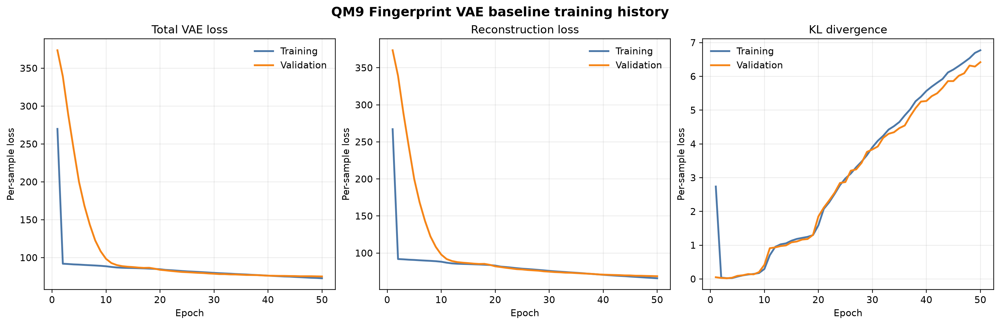

# Experiment Records

This document records completed runs that provide evidence about the model. Results from development samples are retained to verify the pipeline, but are not treated as scientific conclusions.

## Fingerprint VAE validation pipeline check

**Date:** 2026-07-27  
**Purpose:** Verify that the configurable deterministic train/validation workflow executes end to end.  
**Dataset:** `data/qm9_sample.csv` with 3 molecules.  
**Configuration:** `configs/fingerprint_vae.yaml`  
**Seed:** 42  
**Split:** 2 training molecules, 1 validation molecule  
**Model:** Dense Fingerprint VAE, 2048-bit Morgan fingerprint input, 16-dimensional latent space  
**Training:** 50 epochs, Adam, learning rate 0.001, batch size 64

### Recorded outcome

The preprocessing and training commands completed successfully. Training emitted both training and validation total loss, reconstruction loss, and KL-divergence metrics for all 50 epochs. The model checkpoint was written to `models/molecular_vae.pt`.

| Metric | Value |
| --- | --- |
| Lowest recorded validation loss | 45.9923 at epoch 36 |
| Final training loss | 11.1963 at epoch 50 |
| Final validation loss | 63.6155 at epoch 50 |

### Interpretation

The run verifies that the deterministic split and evaluation-only validation path function correctly. Training loss decreases substantially, demonstrating that the pipeline can fit the small development sample.

The validation result is not scientifically meaningful because it represents a single molecule. Its fluctuations are expected and must not be used to compare model quality or select hyperparameters. A larger documented QM9 subset with a held-out test set is required for meaningful evaluation.

## QM9 Fingerprint VAE baseline

**Date:** 2026-07-29  
**Dataset:** 10,000-molecule QM9 subset  
**Training split:** 8,000 molecules  
**Validation split:** 1,000 molecules  
**Test split:** 1,000 molecules  
**Configuration:** `configs/qm9_fingerprint_vae.yaml`  
**Seed:** 42  
**Model:** Dense Fingerprint VAE, 2048-bit Morgan fingerprint input, 16-dimensional latent space  
**Training:** 50 epochs, batch size 128, Adam, learning rate 0.001  

### Final result

| Metric | Value |
| --- | ---: |
| Best validation epoch | 50 |
| Best validation loss | 75.1559 |
| Test total loss | 74.8792 |
| Test reconstruction loss | 68.5376 |
| Test KL divergence | 6.3416 |

### Interpretation

The model trained on 8,000 QM9 molecules, selected the checkpoint with the lowest validation loss, and evaluated the untouched 1,000-molecule test partition once after model selection.

The test loss is close to the validation loss, suggesting that this baseline generalizes consistently across the held-out partitions. The best validation result occurred at the final epoch, indicating that the model was still improving when the 50-epoch run ended.

These results establish the first meaningful Fingerprint VAE baseline for the project. They do not yet measure fingerprint reconstruction accuracy, chemical validity, latent-space neighborhood quality, or molecular-property organization.

### Retained local artifacts

```text
models/qm9_fingerprint_vae.pt
models/qm9_fingerprint_vae_results.json
```

### Training curves

**Figure generated:** 2026-07-30



*Figure 1. Per-sample training and validation total loss, reconstruction loss, and KL divergence for the 16-dimensional Fingerprint VAE trained on the 10,000-molecule QM9 subset. Validation loss decreased throughout the 50-epoch experiment, with the best validation result occurring at epoch 50. The final held-out test loss was comparable to the validation loss, supporting consistent baseline generalization across the prepared QM9 partitions.*