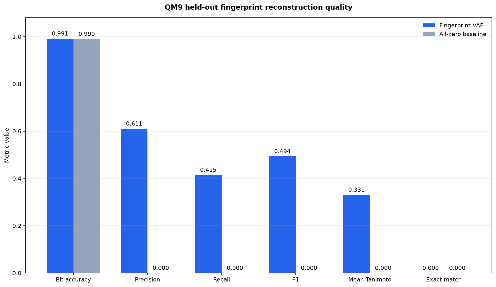
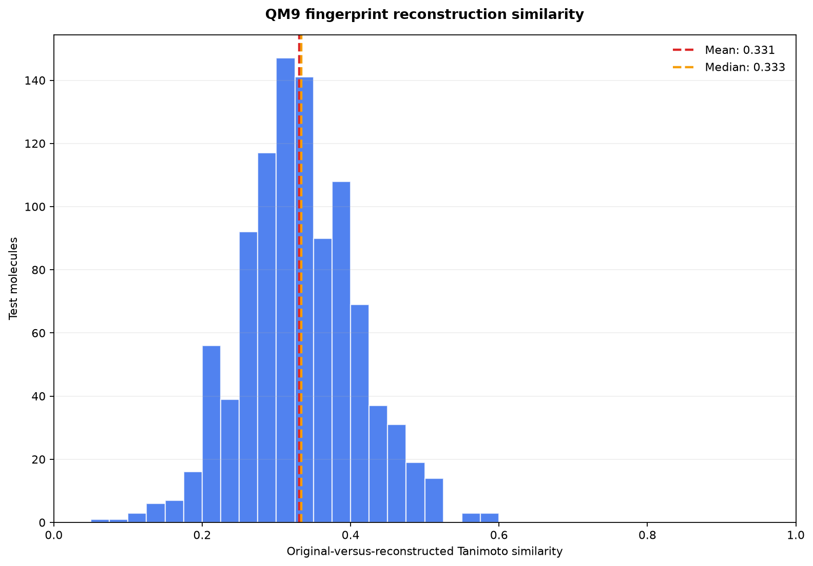

# QM9 Fingerprint Reconstruction Evaluation

> **Key finding:** A probability threshold of `0.25`, selected exclusively on the validation split, achieved a test-set mean Tanimoto similarity of `0.3307` and an F1 score of `0.4940`.

## Purpose

This analysis measures how accurately the trained Fingerprint VAE can reconstruct Morgan fingerprints from its latent representation.

The evaluation uses 1,000 held-out test molecules. The model reconstructs each fingerprint deterministically from the encoder mean (`mu`).

## Threshold selection

Binary fingerprints require converting decoder probabilities into active or inactive bits.

Thresholds from `0.05` to `0.50` were evaluated on the validation split. The threshold maximizing validation mean Tanimoto similarity was `0.25`.

The test split was not used during threshold selection.

## Test results

| Metric | Result |
|---|---:|
| Evaluation molecules | 1,000 |
| Selected threshold | 0.25 |
| Bit accuracy | 0.9915 |
| Precision | 0.6106 |
| Recall | 0.4147 |
| F1 score | 0.4940 |
| Mean Tanimoto | 0.3307 |
| All-zero baseline accuracy | 0.9900 |

> [!IMPORTANT]
> Bit accuracy is unusually high because Morgan fingerprints are sparse. The all-zero baseline already achieves `0.9900`, so F1 and Tanimoto similarity provide more meaningful evidence of reconstruction quality.

## Threshold comparison

| Threshold | Precision | Recall | F1 | Mean Tanimoto |
|---:|---:|---:|---:|---:|
| 0.50 reference | 0.8380 | 0.3026 | 0.4446 | 0.2885 |
| 0.25 selected | 0.6106 | 0.4147 | 0.4940 | 0.3307 |

Lowering the threshold improved recall, F1, and mean Tanimoto while reducing precision. This indicates that threshold `0.5` was too conservative for the sparse fingerprints produced by this model.

## Aggregate metrics



**Figure 8.** Reconstruction metrics on the held-out QM9 test split using the validation-selected probability threshold.

## Per-molecule similarity



**Figure 9.** Distribution of Tanimoto similarity between original and reconstructed Morgan fingerprints for 1,000 test molecules.

## Interpretation

The model learns meaningful fingerprint structure because it performs better than the sparse all-zero solution on F1 and Tanimoto-based measures.

However, a mean Tanimoto similarity of `0.3307` represents partial rather than high-fidelity reconstruction. The model recovers some important fingerprint features but does not reproduce complete fingerprints reliably.

## Reproduce the analysis

Run:

```powershell
python -m backend.evaluate_fingerprint_reconstruction --config configs/qm9_fingerprint_reconstruction.yaml
```

The command generates:
- data/processed/qm9/fingerprint_reconstruction_per_molecule.csv
- data/processed/qm9/fingerprint_reconstruction_summary.json
- docs/FIGURES/qm9-fingerprint-reconstruction-metrics-v1.png
- docs/FIGURES/qm9-fingerprint-reconstruction-tanimoto-v1.png

## Limitations
- Morgan fingerprints are lossy molecular representations.
- Bit accuracy is dominated by inactive bits.
- The selected threshold depends on this model and dataset split.
- Fingerprint reconstruction does not guarantee reconstruction of a valid molecular structure.
- Results currently come from one training seed and one latent dimension.