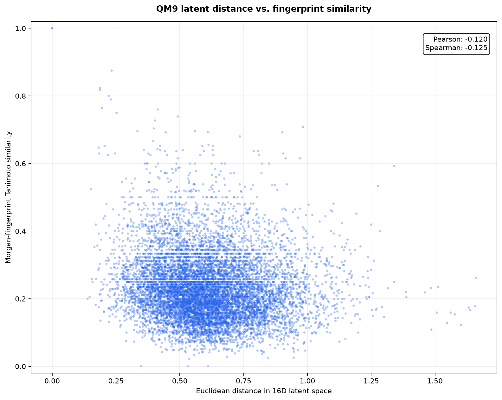
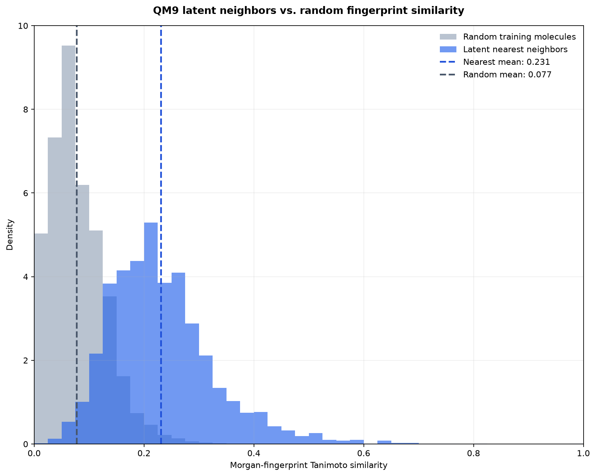

# QM9 Latent-Neighbor Tanimoto Analysis

## Purpose

This analysis evaluates whether molecules that are close in the original 16-dimensional Fingerprint VAE latent space also have similar Morgan fingerprints.

Unlike PCA and UMAP, this analysis uses the original latent vectors and provides a quantitative measure of local molecular-representation quality.

> [!IMPORTANT]
> **Key finding:** Latent nearest neighbors achieve a mean Tanimoto similarity of `0.2312`, compared with `0.0774` for random training molecules.

> [!CAUTION]
> **Interpretation boundary:** The distance/similarity Spearman correlation is only `-0.1252`. Euclidean latent distance is therefore useful for enrichment, but not a strong standalone molecular-similarity measure.

## Reproducible command

Run `python -m backend.analyze_latent_neighbors --config configs/qm9_latent_neighbor_tanimoto.yaml`.

Configuration: `configs/qm9_latent_neighbor_tanimoto.yaml`.

## Method

The analysis uses:

- 1,000 held-out test molecules as queries;
- 8,000 training molecules as references;
- the ten nearest training neighbors for each query;
- Euclidean distance in the original 16-dimensional latent space;
- 2,048-bit Morgan fingerprints with radius 2;
- Tanimoto similarity;
- ten deterministic random training references per query as a baseline.

Validation molecules are not used in this analysis.

## Results

| Metric | Result |
|---|---:|
| Test queries | 1,000 |
| Training references | 8,000 |
| Neighbors per query | 10 |
| Nearest-neighbor comparisons | 10,000 |
| Mean nearest-neighbor Tanimoto | 0.2312 |
| Median nearest-neighbor Tanimoto | 0.2162 |
| Mean random-baseline Tanimoto | 0.0774 |
| Median random-baseline Tanimoto | 0.0732 |
| Absolute mean improvement | 0.1537 |
| Nearest neighbor beats paired random | 94.94% |
| Pearson distance/similarity correlation | -0.1198 |
| Spearman distance/similarity correlation | -0.1252 |

The mean Tanimoto similarity of latent nearest neighbors is approximately three times the random-baseline mean.

## Similarity by neighbor rank

| Rank | Mean Tanimoto |
|---:|---:|
| 1 | 0.2737 |
| 2 | 0.2460 |
| 3 | 0.2391 |
| 4 | 0.2327 |
| 5 | 0.2285 |
| 6 | 0.2238 |
| 7 | 0.2205 |
| 8 | 0.2155 |
| 9 | 0.2137 |
| 10 | 0.2186 |

The first-ranked latent neighbor has the highest mean fingerprint similarity. Similarity generally decreases as neighbor rank increases, with a small non-monotonic change at rank ten.

## Latent distance and fingerprint similarity

**Figure 6.** Euclidean distance in the original 16-dimensional latent space compared with Morgan-fingerprint Tanimoto similarity for the ten nearest training neighbors of each held-out test molecule.

Pearson and Spearman correlations are both weakly negative. This is directionally consistent with the expectation that smaller latent distances should correspond to greater fingerprint similarity, but the relationship is not strong.

The correlation is calculated only among the retrieved top-ten neighbors. It should not be interpreted as a measurement across every possible test-training molecule pair.

## Nearest neighbors compared with random references

**Figure 7.** Distribution of Tanimoto similarities for latent nearest neighbors and deterministic random training references.

The nearest-neighbor distribution is shifted toward higher Tanimoto values compared with the random baseline. In 94.94% of paired comparisons, the retrieved latent neighbor has greater Tanimoto similarity than its random reference.

## Interpretation

The analysis provides quantitative evidence that the learned latent space enriches local neighborhoods for fingerprint similarity.

Latent nearest-neighbor retrieval performs substantially better than random selection. However, the mean nearest-neighbor Tanimoto similarity remains moderate, and latent distance has only a weak monotonic relationship with fingerprint similarity.

The correct conclusion is therefore:

> The Fingerprint VAE latent space retains useful local fingerprint information, but Euclidean latent distance is not a strong or complete measure of molecular similarity.

This result is stronger evidence than visual inspection of PCA or UMAP figures, but it does not establish chemical equivalence or guarantee similar molecular behavior.

## Limitations

- Tanimoto similarity measures Morgan-fingerprint overlap, not complete chemical or biological similarity.
- Different molecules can produce identical or highly similar fingerprints.
- The analysis uses one trained model and one random seed.
- The random baseline is deterministic but represents one sampled baseline.
- Only the ten nearest neighbors are evaluated.
- Euclidean distance may not be the optimal metric for the learned latent space.
- The experiment uses a 10,000-molecule QM9 subset.
- Confidence intervals and repeated-model variability have not yet been measured.

## Completed reconstruction follow-up

Fingerprint reconstruction quality was evaluated on the held-out test split after selecting the probability threshold exclusively on validation data.

The selected threshold of `0.25` produced:

| Metric | Result |
|---|---:|
| Precision | 0.6106 |
| Recall | 0.4147 |
| F1 score | 0.4940 |
| Mean Tanimoto | 0.3307 |

This reconstruction experiment complements the neighbor analysis: neighbor evaluation measures local organization between molecules, while reconstruction evaluation measures how well individual fingerprint information survives encoding and decoding.

See [FINGERPRINT_RECONSTRUCTION.md](FINGERPRINT_RECONSTRUCTION.md).

