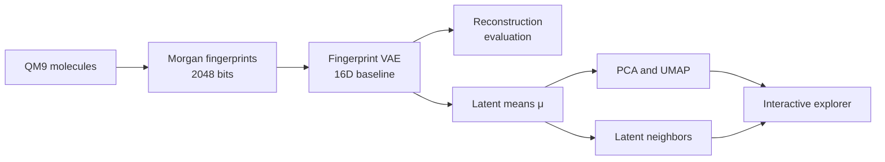

# Methodology

## Study design

Latent Space Explorer is a controlled representation-learning study built around a dense fingerprint variational autoencoder (VAE). It asks whether a compact latent representation learned from molecular fingerprints preserves enough structural information to support reconstruction, visualization, and nearest-neighbor retrieval.

The study uses a deterministic 10,000-molecule subset of QM9, fixed train/validation/test partitions, configuration-driven experiments, and held-out evaluation.



## Dataset preparation

The source QM9 structures are parsed and sanitized with RDKit. Valid molecules are converted to canonical SMILES and joined with their molecular identifiers and HOMO–LUMO gap values. A seeded procedure selects 10,000 molecules and records source provenance in a manifest.

The processed dataset is divided into non-overlapping partitions:

| Split | Molecules | Purpose |
|---|---:|---|
| Training | 8,000 | Learn model parameters and fit projection models |
| Validation | 1,000 | Select checkpoints and reconstruction thresholds |
| Test | 1,000 | Final held-out evaluation and neighbor queries |

The split seed is `42`. The exact split indices are saved so every downstream stage uses the same molecule assignments.

## Molecular representation

Each valid molecule is transformed into a radius-2, 2048-bit Morgan fingerprint:

$$
x \in \{0,1\}^{2048}.
$$

Each bit indicates the presence of a hashed local substructure. Fingerprints provide a fixed-dimensional and computationally practical baseline, but they are lossy and are not directly invertible into guaranteed-valid molecular graphs.

RDKit descriptors are retained as metadata for interpretation rather than used as VAE inputs. They include molecular weight, LogP, atom counts, hydrogen-bond donor and acceptor counts, topological polar surface area, and ring count. The QM9 HOMO–LUMO gap is retained from the source property table.

## Fingerprint VAE

The encoder maps the fingerprint through fully connected layers of sizes `512` and `128`, then predicts a latent mean and log variance. The baseline latent dimension is `16`:

$$
q_\phi(z \mid x)=\mathcal{N}\left(z;\mu,\operatorname{diag}(\sigma^2)\right).
$$

During training, the reparameterization trick samples

$$
z = \mu + \sigma \odot \epsilon,
\qquad
\epsilon \sim \mathcal{N}(0,I).
$$

The decoder maps the latent vector through layers of sizes `128` and `512` and returns 2048 reconstruction logits.

```text
2048 fingerprint bits
  → 512 → 128
  → μ and log σ² (16 dimensions)
  → sampled z
  → 128 → 512
  → 2048 reconstruction logits
```

## Objective and optimization

The training objective combines binary cross-entropy with logits and KL divergence:

$$
\mathcal{L}_{VAE}
=
\mathcal{L}_{reconstruction}
+
\mathcal{L}_{KL}.
$$

The implementation uses an unweighted KL term, equivalent to $\beta=1$. Both loss components use sum reduction within a batch and are reported per molecule.

The retained baseline uses:

| Setting | Value |
|---|---:|
| Seed | 42 |
| Batch size | 128 |
| Learning rate | 0.001 |
| Epochs | 50 |
| Optimizer | Adam |
| Latent dimensions | 16 |

The model is trained only on the training split. The checkpoint with the lowest validation loss is retained, then evaluated once on the held-out test split.

## Deterministic evaluation representation

Training samples stochastic latent vectors. Evaluation and downstream analyses instead use the encoder mean $\mu$. This removes sampling noise and gives each molecule one reproducible latent vector:

$$
\mu(x) \in \mathbb{R}^{16}.
$$

The exported latent matrix and aligned metadata are validated against molecule rows, source indices, SMILES, and dataset splits.

## PCA and UMAP projections

PCA and UMAP convert the 16-dimensional latent means into two-dimensional coordinates for visualization. Both projection models are fitted only on training latent vectors, then used to transform validation and test vectors.

- PCA provides a deterministic linear view of maximum variance.
- UMAP provides a nonlinear neighborhood-oriented view using 15 neighbors, minimum distance `0.1`, Euclidean distance, and fixed random seeds.

Molecular-property coloring is applied after projection. It does not change point coordinates; therefore, figures colored by different properties intentionally show identical point positions with different colors.

## Latent-neighbor evaluation

Each of the 1,000 test molecules is used as a query against the 8,000 training molecules. The analysis retrieves the ten closest references by Euclidean distance in the original 16-dimensional latent space.

Structural overlap is measured separately with Morgan-fingerprint Tanimoto similarity:

$$
T(A,B)=\frac{|A\cap B|}{|A\cup B|}.
$$

A seeded random-reference baseline uses the same number of comparisons. Mean similarity, rank-level results, paired improvement, and Pearson and Spearman distance/similarity correlations quantify whether latent proximity is enriched for fingerprint similarity.

## Fingerprint reconstruction evaluation

The decoder reconstructs fingerprints from deterministic latent means. A probability threshold is selected on the validation split by maximizing mean per-molecule Tanimoto similarity over the configured sweep from `0.05` to `0.50`. That threshold is then fixed and evaluated once on the test split.

Reported metrics include bit accuracy, precision, recall, F1 score, exact-match rate, predicted bit density, and mean per-molecule Tanimoto similarity. An all-zero fingerprint baseline exposes the misleading effect of fingerprint sparsity on bit accuracy.

## Robustness analysis

The robustness experiment trains nine models across latent dimensions `8`, `16`, and `32` and seeds `7`, `42`, and `123`. Each run uses the same split policy, validation-based checkpoint selection, and validation-based reconstruction threshold selection.

Results are aggregated by latent dimension using the arithmetic mean and sample standard deviation. This measures sensitivity to initialization and latent capacity within the scope of the selected subset and training protocol.

## Browser data integration

The backend validates and exports aligned PCA, UMAP, molecular-property, neighbor, reconstruction, robustness, and manifest data as versioned JSON. The React/Plotly application loads these static artifacts and performs interactive filtering and selection in the browser.

The web application is an exploration layer, not an inference service. It does not train the model, encode new molecules, decode latent vectors, or recompute scientific metrics.

## Interpretation boundaries

- The study evaluates fingerprint representation learning, not valid molecule generation.
- Two-dimensional PCA and UMAP views cannot preserve every relationship in 16 dimensions.
- Tanimoto similarity measures fingerprint overlap, not complete chemical or biological equivalence.
- Random molecule-level splits do not establish scaffold-level generalization.
- The deterministic 10,000-molecule subset does not represent the full diversity of QM9 or drug-like chemical space.
- The robustness grid measures variability across three seeds and three latent dimensions, not every modeling choice.
