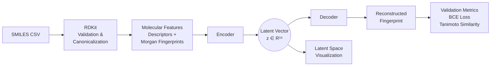
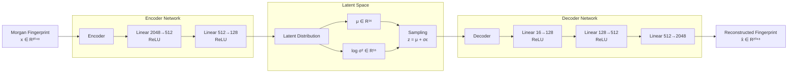

# Methodology

## Overview
<div align="justify">
The Molecular Latent Space Explorer currently implements a **Fingerprint Variational Autoencoder (VAE) baseline**.

The workflow transforms molecular SMILES strings into fixed-length Morgan fingerprints, compresses them into a 16-dimensional latent representation, and reconstructs the fingerprint representation.



---

# Molecular Preprocessing

## Input Data

The input data is provided as a CSV file containing a required:

```text
smiles
```

column.

The preprocessing pipeline performs the following steps:

1. Reads the source CSV file.
2. Validates each SMILES string using RDKit.
3. Removes invalid molecules.
4. Creates canonical SMILES representations.
5. Calculates molecular descriptors.
6. Generates Morgan fingerprints.
7. Saves metadata and fingerprint artifacts.

---

## Molecular Descriptors

The preprocessing stage extracts molecular descriptors used for analysis and visualization.

| Descriptor | Description |
|---|---|
| Molecular weight | Total molecular mass of the molecule |
| LogP | Estimate of molecular lipophilicity |
| Atom count | Total number of atoms |
| Heavy-atom count | Number of non-hydrogen atoms |
| Hydrogen-bond donor count | Number of hydrogen-bond donor groups |
| Hydrogen-bond acceptor count | Number of hydrogen-bond acceptor groups |
| Topological polar surface area (TPSA) | Descriptor related to molecular polarity |
| Ring count | Number of molecular rings |

These descriptors are not used as direct inputs to the VAE. They are preserved as molecular metadata for later analysis of the learned latent space.

---

# Morgan Fingerprints

Each valid molecule is transformed into a **2048-bit Morgan fingerprint**.

The current implementation uses:

```text
Radius: 2
Fingerprint size: 2048 bits
```

Morgan fingerprints represent molecular structures as fixed-dimensional binary vectors.

Formally, each molecule is transformed into:

$$
x \in \{0,1\}^{2048}
$$

where each element represents the presence or absence of a hashed molecular substructure.

Morgan fingerprints are suitable for the current baseline because they are:

- Compact.
- Computationally efficient.
- Widely used in cheminformatics.

However, they have an important limitation:

> Morgan fingerprints do not contain enough structural information to directly decode a chemically valid molecular graph.

Therefore, the current model learns a latent representation of fingerprint space rather than directly generating molecular structures.

---

# Dense Fingerprint VAE

The current VAE architecture is:



The encoder maps the original fingerprint representation into a lower-dimensional latent representation:

$$
x \in \{0,1\}^{2048}
\rightarrow
z \in \mathbb{R}^{16}
$$

where:

- \(x\) is the input Morgan fingerprint.
- \(z\) is the learned latent representation.

---

# Latent Representation and Reparameterization

The encoder does not directly output a single latent vector.

Instead, it learns the parameters of a probability distribution:

$$
q_\phi(z|x)=\mathcal{N}(z;\mu,\sigma^2)
$$

where:

- $\mu$ represents the latent mean vector.
- $\sigma^2$ represents the latent variance.
- $q_\phi(z|x)$ represents the learned latent distribution.

The latent vector is sampled using the reparameterization trick:

$$
z = \mu + \sigma \odot \epsilon
$$

where:

$$
\epsilon \sim \mathcal{N}(0,I)
$$

This allows gradients to flow through the stochastic sampling process during training.

---

# VAE Objective Function

The VAE is trained by minimizing a combination of reconstruction loss and KL divergence:

$$  \mathcal{L}_{VAE}=
\mathcal{L}_{reconstruction}
+
\beta\mathcal{L}_{KL}
$$

where:

- $L_{reconstruction}$ measures how accurately the original molecular fingerprint is reconstructed by the decoder.
- $L_{KL}$ regularizes the latent distribution and encourages the latent space to follow a structured normal distribution.
- $\beta$ controls the contribution of the KL divergence term in the total VAE objective.


For the current implementation:

$$
\beta = 1
$$

---

# Reconstruction Loss

The reconstruction loss is calculated using binary cross-entropy with logits between the original fingerprint and reconstructed fingerprint output.

The binary cross-entropy formulation is:

$$ \mathcal{L}_{reconstruction}=
-\sum_{i=1}^{n}
\left[
x_i\log(\hat{x_i})
+
(1-x_i)\log(1-\hat{x_i})
\right]
$$

where:

- $x_i$ represents the original fingerprint bit.
- $\hat{x_i}$ represents the reconstructed fingerprint probability.

The reconstruction term encourages the decoder to preserve molecular fingerprint information.

---

# KL Divergence

The KL divergence term encourages the learned latent distribution to approximate a standard normal distribution:

$$ \mathcal{L}_{KL}=
D_{KL}
\left(
q_\phi(z|x)
\parallel
p(z)
\right)
$$

For a Gaussian latent distribution, the closed-form expression becomes:

$$
\mathcal{L}_{KL} =
-\frac{1}{2}
\sum_{i=1}^{d}
\left(
1+\log(\sigma_i^2)-\mu_i^2-\sigma_i^2
\right)
$$

where:

- $d$ is the latent dimension.
- $\mu_i$ is the latent mean for dimension $i$.
- $\sigma_i^2$ is the latent variance for dimension $i$.

Together, reconstruction loss and KL divergence encourage the model to:

- Preserve molecular fingerprint information.
- Learn a continuous latent representation.
- Organize molecules into a structured latent space.

---

# Training and Validation

Training configuration is stored in:

```text
configs/fingerprint_vae.yaml
```

The configuration defines:

| Parameter | Description |
|---|---|
| Dataset path | Location of processed fingerprint data |
| Random seed | Ensures reproducible experiments |
| Model dimensions | Encoder, decoder, and latent sizes |
| Batch size | Number of samples processed per update |
| Learning rate | Optimizer step size |
| Epoch count | Number of training iterations |
| Validation fraction | Training/validation split ratio |
| Checkpoint path | Location of saved model artifacts |

---

## Training Workflow

The dataset is divided into deterministic training and validation subsets using the configured random seed.

During each epoch:

1. The model updates parameters using training batches.
2. Total loss, reconstruction loss, and KL divergence are recorded.
3. Validation data is evaluated without gradient updates.
4. Validation metrics are recorded.
5. Training history and configuration metadata are saved in the checkpoint.

The saved checkpoint contains:

- Model parameters.
- Experiment configuration.
- Dataset split information.
- Training history.
- Random seed.

---

# Current Evaluation Scope

The current three-molecule development sample verifies that:

- Molecular preprocessing executes correctly.
- Morgan fingerprint generation works.
- The VAE training workflow runs end-to-end.
- Validation evaluation functions correctly.
- Checkpoint generation works.

However, this dataset does **not** support scientific conclusions about:

- Model generalization.
- Molecular clustering.
- Reconstruction quality.
- Chemical interpretation of the latent space.

A scientifically meaningful evaluation requires:

- A larger documented QM9 subset.
- Train/validation/test splits.
- Held-out test evaluation.
- Comparison between different model configurations.
- Analysis of latent-space organization.

</div>
