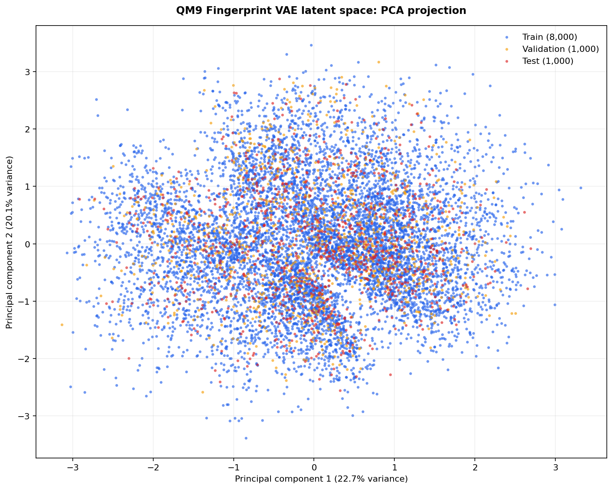

# QM9 Latent PCA Analysis

## Purpose

This document records the first two-dimensional visualization of the QM9 Fingerprint VAE latent space.

The analysis projects deterministic 16-dimensional latent mean vectors into two dimensions using Principal Component Analysis (PCA).

## Reproducible command

Run:

```powershell
python -m backend.plot_latent_pca
```

Configuration:

```text
configs/qm9_latent_pca.yaml
```

## Method

The workflow uses:

- latent vectors exported from the selected QM9 Fingerprint VAE checkpoint;
- one deterministic latent mean vector for each of 10,000 molecules;
- PCA with two output components;
- PCA fitting on the 8,000-molecule training split only;
- transformation of validation and test molecules using the training-fitted PCA model.

Fitting PCA only on training vectors prevents the validation and test partitions from influencing the learned projection axes.

## Result

| Metric | Value |
| --- | --- |
| Projected molecules | 10,000 |
| Input latent dimensions | 16 |
| PCA output dimensions | 2 |
| PCA fitting split | Training |
| PC1 explained variance | 22.7% |
| PC2 explained variance | 20.1% |
| Total explained variance | 42.8% |

## Figure



*Figure 2. PCA projection of deterministic 16-dimensional QM9 Fingerprint VAE latent mean vectors. PCA was fitted on the 8,000-molecule training split and then applied to validation and test molecules. The three deterministic splits overlap across the same broad regions, indicating that they are distributed similarly in the projected latent space.*

## Interpretation

The first two principal components retain 42.8% of the variance present in the 16-dimensional latent vectors. This makes PCA a useful first overview, but more than half of the variation remains outside the two-dimensional projection.

Training, validation, and test molecules overlap rather than forming visibly separate regions. This is expected for a deterministic random split and provides visual evidence that the partitions have similar overall latent distributions.

This split-colored figure alone is not sufficient evidence of chemically meaningful clusters. However, the completed property-colored projections show that several molecular descriptors vary systematically across parts of the map, while the neighbor analysis shows that latent neighbors are more fingerprint-similar than random references. These results support structured latent organization without proving complete chemical similarity.

## Limitations

- PCA is a linear projection and may not preserve nonlinear local relationships.
- The first two components retain only 42.8% of the latent variance.
- Two-dimensional proximity is not identical to distance in the original 16-dimensional space.
- This split-colored figure does not directly display molecular-property values or Tanimoto similarity.
- Visible regions should not be described as chemical clusters without quantitative validation.
- Reconstruction quality must be interpreted using the separate held-out reconstruction evaluation.

Related analyses are documented in [PROPERTY_ANALYSIS.md](PROPERTY_ANALYSIS.md), [LATENT_NEIGHBOR_ANALYSIS.md](LATENT_NEIGHBOR_ANALYSIS.md), and [FINGERPRINT_RECONSTRUCTION.md](FINGERPRINT_RECONSTRUCTION.md).