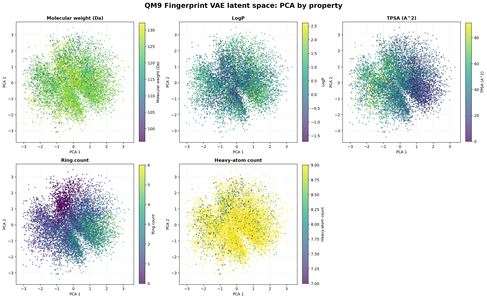
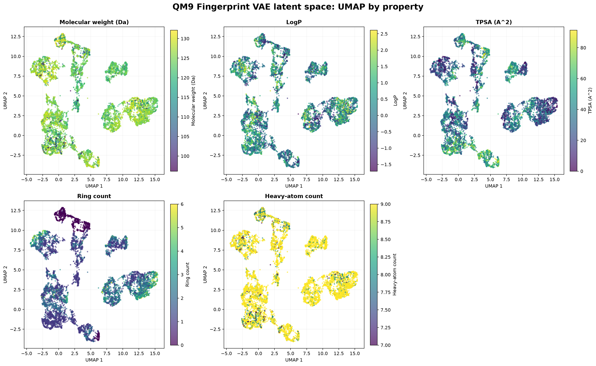

# QM9 Molecular-Property Latent-Space Analysis

## Purpose

This analysis examines whether measurable molecular properties show visible organization across the learned QM9 Fingerprint VAE latent space.

The existing PCA and UMAP coordinates are preserved. Each molecule remains at the same projected position in every panel, while its color changes according to the selected molecular property.

## Reproducible command

Run `python -m backend.plot_latent_properties --config configs/qm9_property_visualizations.yaml`.

Configuration: `configs/qm9_property_visualizations.yaml`.

## Data and alignment

The analysis uses deterministic metadata for 10,000 QM9 molecules:

- 8,000 training molecules;
- 1,000 validation molecules;
- 1,000 test molecules.

PCA metadata, UMAP metadata, molecule identifiers, canonical SMILES, split labels, and molecular-property values are validated for row-level alignment before either figure is generated.

## Molecular properties

| Property | Minimum | Maximum | Mean | Median |
|---|---:|---:|---:|---:|
| Molecular weight (Da) | 16.043 | 144.092 | 122.751 | 125.127 |
| LogP | -2.6147 | 3.4687 | 0.3266 | 0.2864 |
| TPSA | 0.00 | 122.78 | 36.71 | 35.53 |
| Ring count | 0 | 8 | 1.7504 | 1 |
| Heavy-atom count | 1 | 9 | 8.7978 | 9 |

Colors are clipped at the first and ninety-ninth percentiles to reduce visual domination by extreme values. The underlying property values are not modified.

## PCA visualization

**Figure 4.** PCA projection of deterministic 16-dimensional latent mean vectors colored by molecular weight, LogP, TPSA, ring count, and heavy-atom count. Every panel uses the same PCA coordinates.

## PCA interpretation

The PCA panels show broad overlapping property distributions rather than sharply separated groups.

TPSA and ring count display visible directional variation across parts of the projection. LogP also varies across the space, but its pattern is not represented by a single simple linear gradient.

Molecular weight and heavy-atom count appear visually similar because these properties are strongly related in this QM9 subset. Most molecules contain close to nine heavy atoms, so the heavy-atom panel has a limited effective color range.

These observations indicate that some molecular-property information may be represented in the latent vectors, but the PCA visualization alone does not quantify that relationship.

## UMAP visualization

**Figure 5.** Training-fitted UMAP projection of deterministic 16-dimensional latent mean vectors colored by molecular weight, LogP, TPSA, ring count, and heavy-atom count. Every panel uses the same UMAP coordinates.

## UMAP interpretation

UMAP reveals locally connected regions with different property distributions.

LogP, TPSA, and ring count show visible local changes across several projected regions. Some UMAP regions contain predominantly lower or higher values, suggesting that local latent neighborhoods may retain molecular-property information.

Molecular weight and heavy-atom count again show related color patterns. Heavy-atom count is visually dominated by molecules with nine heavy atoms because this value is highly frequent in the selected subset.

The visible UMAP regions should not be interpreted as complete chemical clusters. UMAP can distort global distance, region size, orientation, and separation, while property gradients describe only the selected molecular descriptors.

## Comparison of PCA and UMAP

PCA provides a linear global view, while UMAP emphasizes nonlinear local neighborhoods.

Both projections suggest that molecular properties are not distributed completely randomly across the latent space. UMAP makes local property patterns more visible, whereas PCA provides a more conservative global overview.

The figures provide exploratory evidence of structured property variation. The completed latent-neighbor analysis provides a separate quantitative test of whether proximity in the original 16-dimensional space corresponds to Morgan-fingerprint similarity.

## Limitations

- The figures do not measure statistical significance.
- The projections reduce 16 latent dimensions to only two dimensions.
- UMAP does not preserve all global distances.
- Quantile clipping compresses extreme property values in the color scale.
- Ring count and heavy-atom count are discrete properties displayed with continuous color maps.
- Property gradients do not prove that latent neighbors are chemically similar.
- Tanimoto similarity is evaluated separately in the original 16-dimensional latent space rather than inferred from two-dimensional plot distance.

## Completed quantitative follow-up

The latent-neighbor experiment evaluated 1,000 held-out test queries against 8,000 training references.

Mean neighbor Tanimoto similarity was `0.2312`, compared with `0.0774` for the random baseline. This shows that the learned representation enriches local neighborhoods for fingerprint similarity.

However, the Spearman correlation between latent distance and Tanimoto similarity was only `-0.1252`. Latent proximity is therefore informative but not a complete molecular-similarity measure.

See [LATENT_NEIGHBOR_ANALYSIS.md](LATENT_NEIGHBOR_ANALYSIS.md).