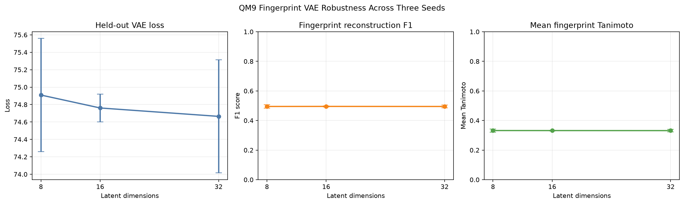

# QM9 Fingerprint VAE Robustness Analysis

> **Key finding:** Reconstruction performance remained nearly unchanged across latent dimensions `8`, `16`, and `32`. The 16-dimensional model showed the lowest variation across random seeds.

## Research question

How stable are Fingerprint VAE results across random initialization and latent-space dimensionality?

## Experimental design

Nine models were trained using:

- latent dimensions: `8`, `16`, and `32`;
- random seeds: `7`, `42`, and `123`;
- 50 epochs per run;
- identical QM9 data splits and training settings.

For every run, the best checkpoint was selected using validation loss. The reconstruction threshold was selected using validation mean Tanimoto similarity and then applied to the held-out test split.

## Results

Values are reported as mean ± sample standard deviation across three seeds.

| Latent dimensions | Test loss | Reconstruction F1 | Mean Tanimoto |
|---:|---:|---:|---:|
| 8 | 74.9092 ± 0.6494 | 0.4949 ± 0.0118 | 0.3322 ± 0.0110 |
| 16 | 74.7608 ± 0.1595 | 0.4953 ± 0.0034 | 0.3320 ± 0.0034 |
| 32 | 74.6645 ± 0.6494 | 0.4949 ± 0.0098 | 0.3317 ± 0.0090 |

## Comparison figure



**Figure 10.** Mean held-out VAE loss, fingerprint reconstruction F1, and mean Tanimoto similarity across three random seeds. Error bars show sample standard deviation.

## Interpretation

Increasing the latent dimension slightly reduced mean VAE test loss. However, this did not improve fingerprint reconstruction F1 or mean Tanimoto similarity.

The 16-dimensional configuration produced the smallest variation across seeds for all three reported metrics. It therefore remains a reasonable default for the project.

The 8-dimensional model achieved nearly identical reconstruction performance with stronger compression. The 32-dimensional model increased capacity without producing a measurable reconstruction advantage.

> [!IMPORTANT]
> The overlapping error bars do not support claiming that one latent dimension is definitively superior. The results instead show that reconstruction quality is robust across the tested dimensions.

## Reproduce the experiment

Run:

```powershell
python -m backend.run_robustness_analysis --config configs/qm9_robustness.yaml --execute
```

Completed runs are automatically reused, allowing interrupted experiments to resume without retraining finished models.

## Limitations

- Only three random seeds were evaluated.
- Only latent dimensions 8, 16, and 32 were compared.
- The experiment uses the deterministic 10,000-molecule QM9 subset.
- Error-bar overlap is descriptive and is not a formal significance test.
- Reconstruction quality remains moderate despite being stable.