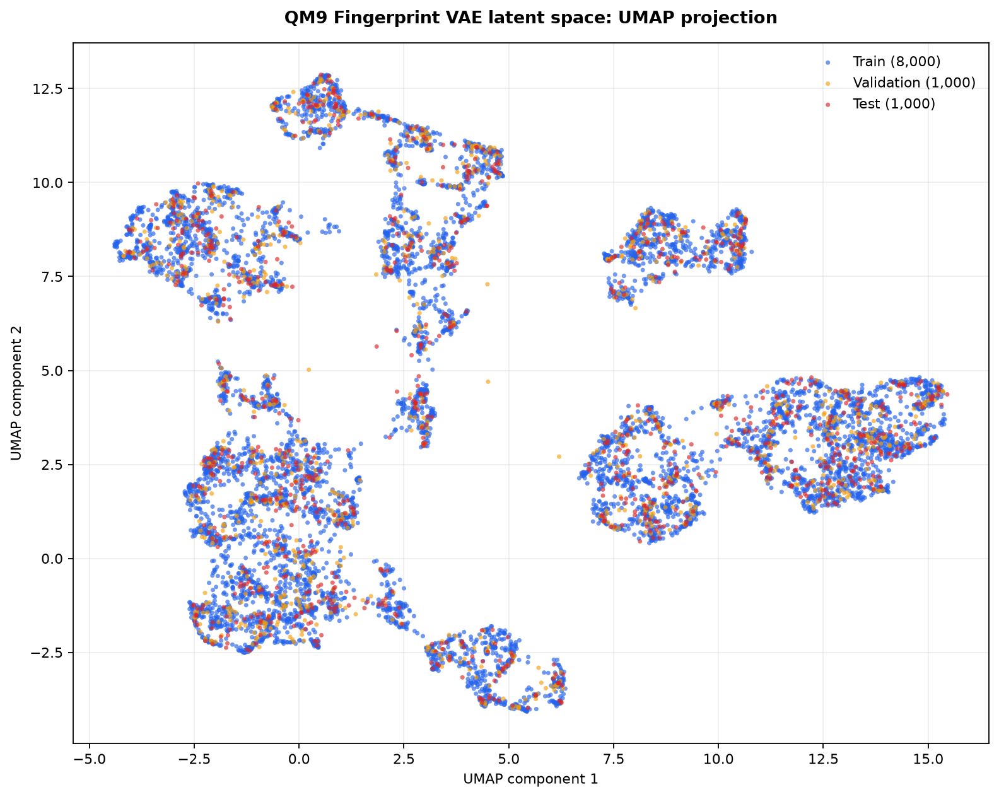

# QM9 Latent UMAP Analysis

## Purpose

This document records the first nonlinear two-dimensional visualization of the QM9 Fingerprint VAE latent space.

The analysis projects deterministic 16-dimensional latent mean vectors into two dimensions using Uniform Manifold Approximation and Projection (UMAP).

## Reproducible Command

Run:

```powershell
python -m backend.plot_latent_umap --config configs/qm9_latent_umap.yaml
```

Configuration:

```text
configs/qm9_latent_umap.yaml
```

## Method

The workflow uses:

- deterministic latent mean vectors for 10,000 QM9 molecules;
- a two-dimensional UMAP projection;
- fitting on the 8,000-molecule training split only;
- transformation of the 1,000 validation and 1,000 test molecules using the training-fitted UMAP model;
- explicit random seeds for fitting and transformation;
- Euclidean distance in the 16-dimensional latent space.

Fitting UMAP only on training vectors prevents validation and test molecules from influencing the learned projection.

## Configuration

| Parameter | Value |
|---|---|
| Input latent dimensions | 16 |
| Output dimensions | 2 |
| Fitting split | Training |
| Training molecules | 8,000 |
| Validation molecules | 1,000 |
| Test molecules | 1,000 |
| Neighbors | 15 |
| Minimum distance | 0.1 |
| Metric | Euclidean |
| Random state | 42 |
| Transform seed | 42 |

## Figure



**Figure 3.** *UMAP projection of deterministic 16-dimensional QM9 Fingerprint VAE latent mean vectors. UMAP was fitted on the training split and then used to transform validation and test molecules. All three splits occupy the same projected regions.*

## Interpretation

The UMAP projection contains several separated regions and locally connected structures. Training, validation, and test points remain intermingled throughout these regions rather than forming split-specific groups. This is consistent with the three deterministic dataset partitions having similar overall latent distributions.

The visible regions cannot yet be interpreted as chemically meaningful clusters. The figure is colored only by dataset split, and no molecular property or fingerprint-similarity measurement has been associated with the projected neighborhoods.

## Comparison with PCA

PCA provides a linear global overview in which the first two components explain 42.8% of the latent variance. UMAP produces a more visibly separated nonlinear layout and emphasizes local neighborhood relationships.

The shapes, distances, orientation, and sizes of UMAP regions should not be compared directly with PCA geometry. UMAP does not provide an explained-variance measure, and large distances between projected regions do not necessarily represent proportional distances in the original latent space.

Together, PCA and UMAP show that the dataset splits cover similar projected regions. Neither visualization alone demonstrates that nearby molecules are chemically similar.

## Limitations

- UMAP can distort global distances, region sizes, and relative positions.
- The projection depends on its selected parameters and random seeds.
- Visible regions have not been validated using molecular properties.
- Latent-space neighbors have not been compared using Tanimoto similarity.
- The visualization does not measure fingerprint reconstruction quality.
- A two-dimensional projection cannot preserve every relationship in the original 16-dimensional latent space.

