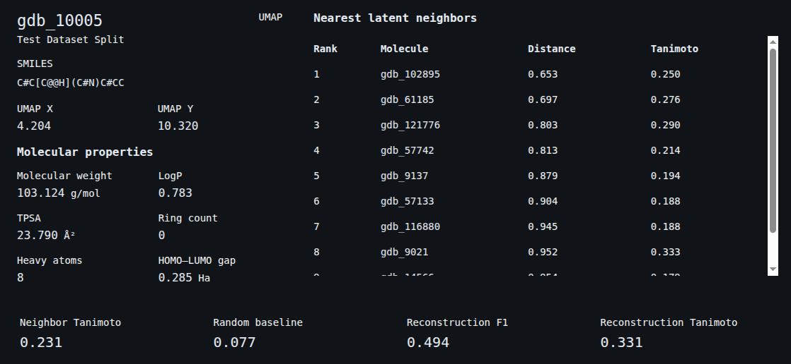

# Latent Space Explorer Frontend

The frontend is an interactive scientific interface for exploring molecular representations learned by the QM9 fingerprint VAE.
The application loads versioned browser artifacts generated by the Python backend and visualizes all 10,000 aligned QM9 molecules.

**Live explorer:** <https://latent-space-explorer-black.vercel.app/>



## Features

- interactive PCA and UMAP molecular maps;
- WebGL rendering for 10,000 points;
- molecular-property coloring by molecular weight, LogP, TPSA, ring count, heavy-atom count, and HOMO–LUMO gap;
- zooming, panning, and hover information;
- molecule selection and ID search;
- train, validation, and test filtering;
- molecular-property range filtering;
- selected-molecule coordinates, SMILES, and properties;
- latent-neighbor distance and Tanimoto comparison;
- loading, error, and schema-validation states;
- responsive layout that shows the map first on phones.

## Technology

| Area | Technology |
|---|---|
| Application | React |
| Development and build | Vite |
| Scientific visualization | Plotly WebGL (`plotly.js-gl2d-dist-min`) |
| Styling | CSS |
| Data | Versioned JSON exports |

## Local setup

Requirements: Node.js 20.19+ or 22.12+, and a browser with WebGL enabled.

```bash
cd web
npm ci
npm run dev
```

Vite prints the local address, usually <http://localhost:5173>.

| Command | Purpose |
|---|---|
| `npm run dev` | Start the development server with hot reload. |
| `npm run lint` | Check the source with ESLint. |
| `npm run build` | Create the production build in `web/dist/`. |
| `npm run preview` | Serve the production build locally. |

## Source layout

| Path | Responsibility |
|---|---|
| `src/App.jsx` | Dashboard layout, application state, search, and filter handling. |
| `src/components/LatentScatterPlot.jsx` | Plotly WebGL scatter plot, including the compact phone layout. |
| `src/components/ExplorerFilters.jsx` | Dataset-split and property-range filters. |
| `src/components/MoleculeInspector.jsx` | Selected-molecule properties and the nearest-neighbor table. |
| `src/data/loadExplorerData.js` | Loads the manifest and data files and validates their schema. |
| `src/data/filterMolecules.js` | Split and property-range filtering. |
| `src/hooks/useExplorerData.js` | Loading, error, and retry state for the data. |

## Data

The explorer reads four static files from `public/data/`:

| File | Contents |
|---|---|
| `qm9_web_export_manifest.json` | Schema version, counts, file names, sizes, SHA-256 checksums, and interpretation warnings. |
| `qm9_molecules.json` | Identity, SMILES, split, PCA and UMAP coordinates, and properties for 10,000 molecules. |
| `qm9_neighbors.json` | Ten nearest training neighbors for each of the 1,000 held-out test molecules. |
| `qm9_metrics.json` | Neighbor, reconstruction, threshold-sweep, and robustness summaries. |

These files are generated by the backend and committed so that the explorer runs without the Python pipeline. To regenerate them, run the full workflow in [REPRODUCIBILITY.md](../docs/REPRODUCIBILITY.md) and then:

```bash
python -m backend.export_web_data --config configs/qm9_web_export.yaml
```

The data contracts are documented in [WEB_DATA_EXPORT.md](../docs/WEB_DATA_EXPORT.md).

## Validation

Before merging a change, run:

```bash
npm run lint
npm run build
```

The same checks run automatically on every pull request through GitHub Actions, together with the backend test suite.

## Deployment

The explorer is deployed on Vercel from the `main` branch:

| Setting | Value |
|---|---|
| Root directory | `web` |
| Framework preset | Vite |
| Build command | `npm run build` |
| Output directory | `dist` |

Every merge to `main` redeploys the site, and every pull request receives a preview deployment.

## Scientific boundaries

The explorer displays precomputed results. It does not train the model, compute latent vectors, or recalculate metrics in the browser.

- PCA and UMAP coordinates are two-dimensional projections and do not preserve every latent-space relationship.
- UMAP region size and global separation must not be interpreted as proportional molecular distance.
- Tanimoto similarity measures Morgan-fingerprint overlap rather than complete chemical or biological similarity.
- The decoder reconstructs fingerprints and does not generate guaranteed valid molecular structures.
- Neighbor results exist only for the 1,000 held-out test molecules.
